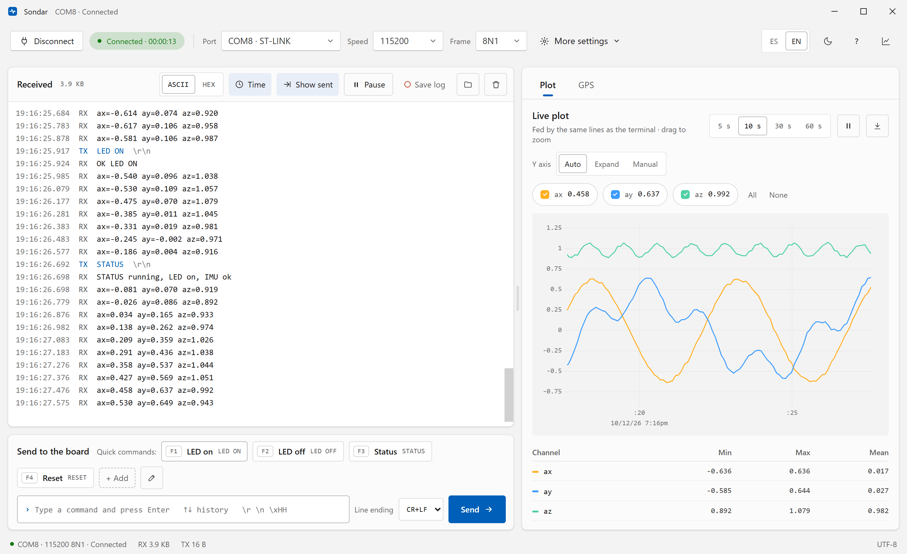
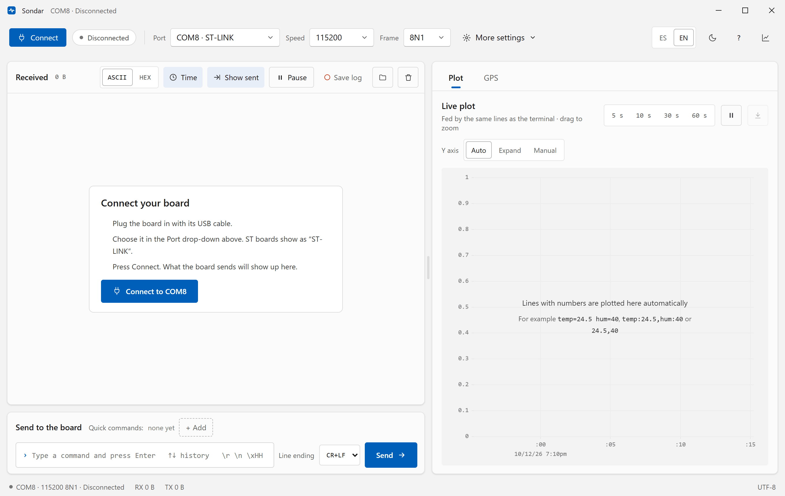
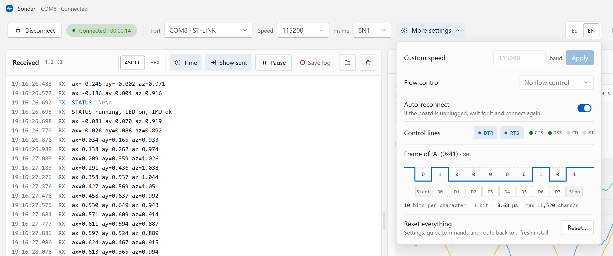
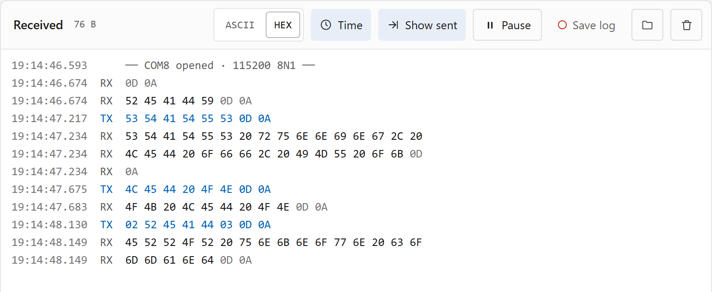
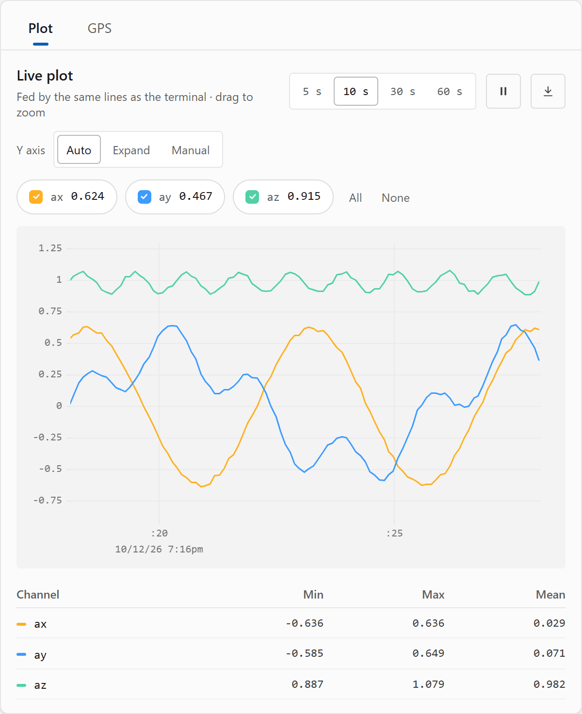
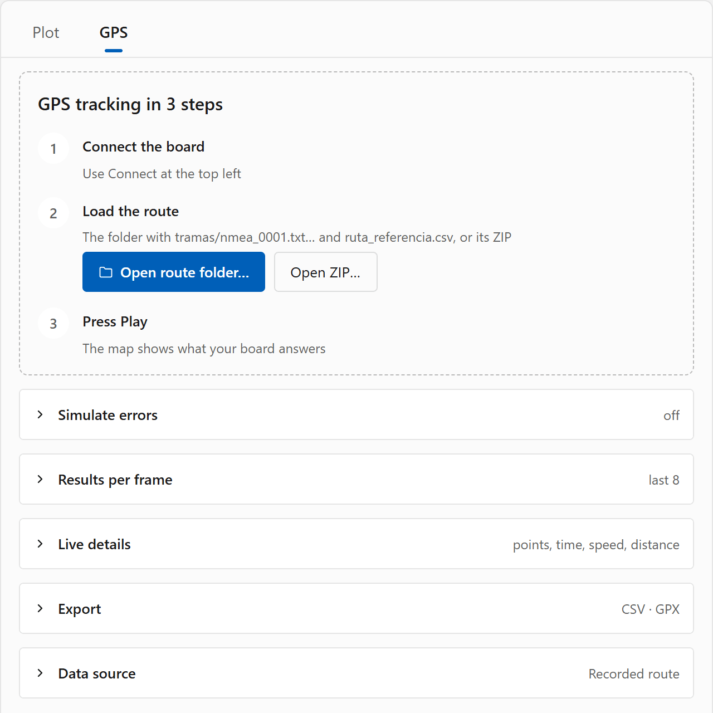
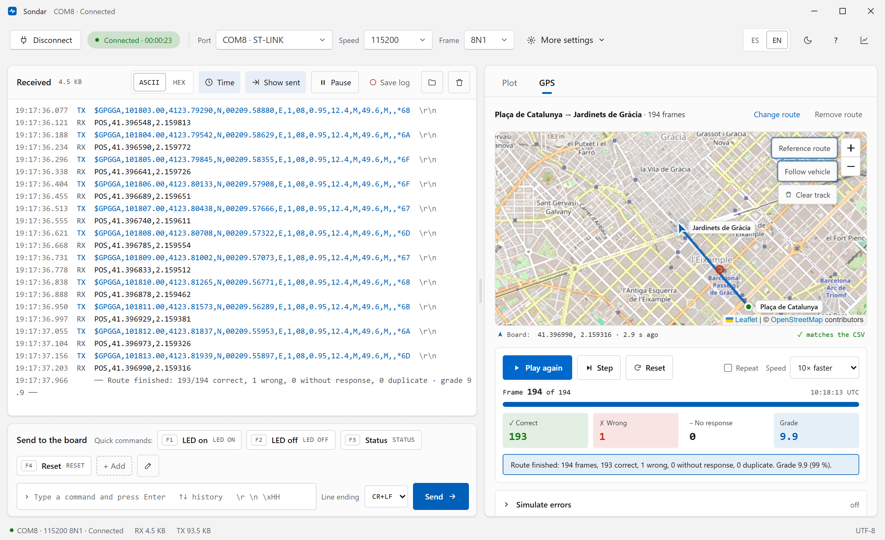
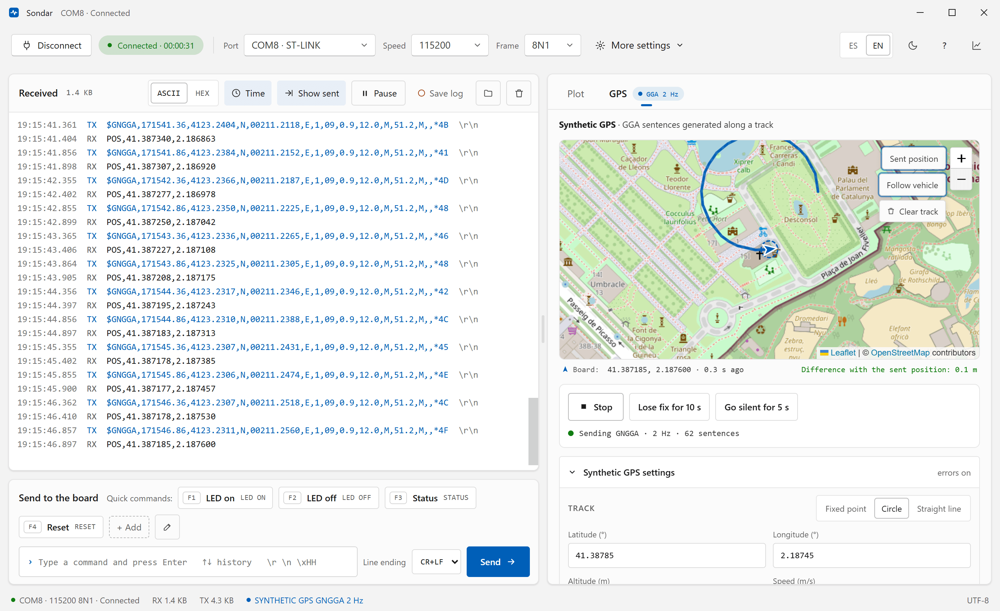
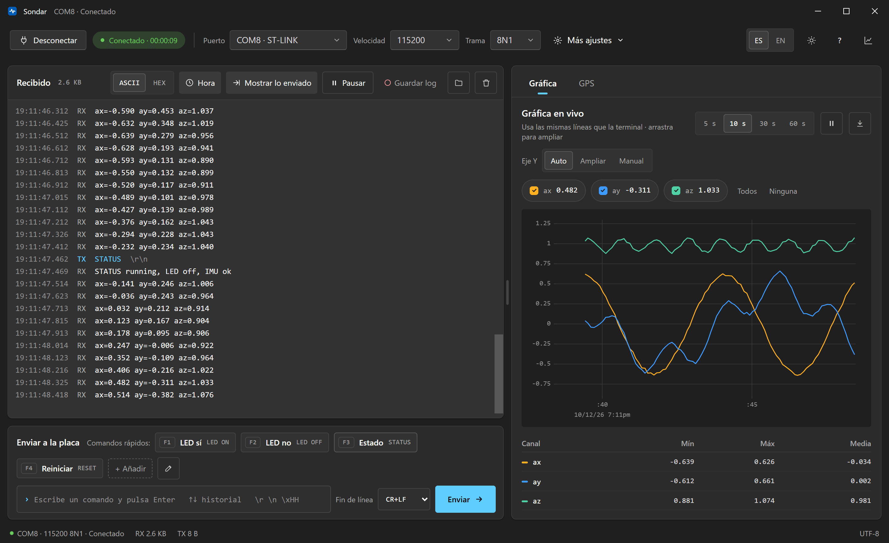
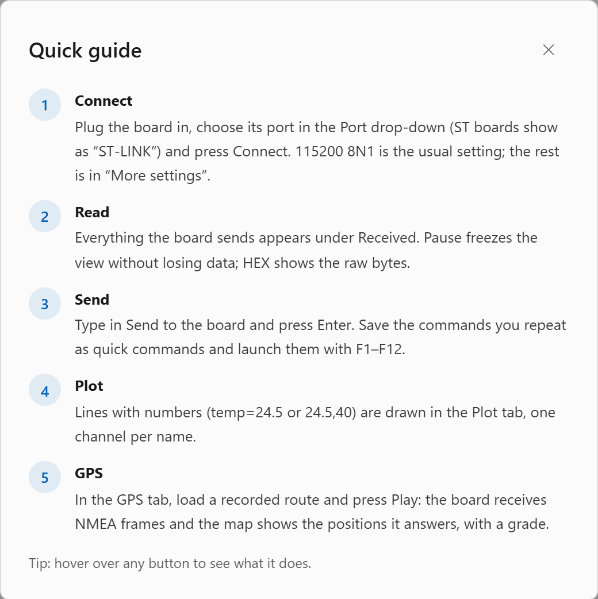

<p align="center">
  
</p>

<h1 align="center">Sondar</h1>

<p align="center">
  <b>The serial terminal for microcontrollers that also plots your data and tests your GPS parser.</b><br>
  Plug in your board, press Connect, and read. Free and open source.
</p>

<p align="center">
  <a href="../../releases/latest"><b>Download for Windows</b></a> ·
  <a href="#quick-start">Quick start</a> ·
  <a href="#a-tour-of-sondar">Tour</a> ·
  <a href="#troubleshooting">Troubleshooting</a> ·
  <a href="#development">Build from source</a>
</p>

<p align="center">
  
  
  
</p>

<p align="center">
  
</p>

<p align="center"><sub>Above: a board streams accelerometer readings (<code>ax=… ay=… az=…</code>). The terminal shows every line with its time, the plot draws the three channels, and the commands sent (<code>LED ON</code>, <code>STATUS</code>) appear in blue among the replies.</sub></p>

## Why Sondar

- **One window, no setup**: Port, speed and frame are three drop-downs. If there is a single board (or a single ST-LINK) plugged in, it is picked for you. The usual setting, 115200 8N1, is the default.
- **Terminal and plot on the same data**: Any line with numbers is plotted as it arrives, next to the terminal. You don't need a separate plotter tool and you don't have to change your firmware's output format.
- **Built for teaching UART**: A UART frame diagram, RX/TX tags in color, a HEX view, and a GPS module simulator that grades how the board parses NMEA.
- **Looks and feels like Windows 11**: System fonts, light and dark mode that follow Windows, and Spanish or English (your system language by default).

## Quick start

1. **Download and install.** Get the installer (`Sondar_x.y.z_x64-setup.exe`) from the [Releases page](../../releases/latest) and run it. Sondar then opens from the Start menu like any other app.
   > **Nothing else to install.** The installer contains the whole app. Node.js, Rust and the other tools in this repository are only needed to [build Sondar from source](#development).
   >
   > The installer is not code-signed yet. If Windows SmartScreen says *"Windows protected your PC"*, click **More info → Run anyway**.
2. **Plug in your board** with its USB cable. ST Nucleo and Discovery boards show up as **ST-LINK**.
3. **Press Connect.** Everything the board sends appears under **Received**.

<p align="center">
  
</p>

The first time you start Sondar it shows you these steps right in the terminal. Here the port **COM8 · ST-LINK** was picked automatically because it is the only ST board plugged in. **Connect to COM8** does the same as the blue **Connect** button at the top left.

Don't see your board? Check [Troubleshooting](#troubleshooting).

## A tour of Sondar

### 1. Connect: everything in one bar

The top bar has everything you need to connect:

| Control | What it does |
|---|---|
| **Connect / Disconnect** | Opens or closes the port. While connected, a green pill shows the time since you connected. |
| **Port** | Lists the serial ports with a short name (`COM8 · ST-LINK`, `COM5 · USB-SERIAL CH340`…). The list refreshes by itself when you plug in a board. |
| **Speed** | Baud rate, from 300 to 2,000,000. **Other…** lets you type any value. |
| **Frame** | Data bits, parity and stop bits. The common ones (8N1, 8E1, 7E1…) come first and every other combination is listed below them. |
| **ES / EN**, ☾, **?**, chart icon | Language, light or dark mode, the quick guide, and show or hide the side panel. |

Port, speed and frame are locked while connected, so you can't change them halfway through a session by mistake. The rest of the settings live in **More settings**:

<p align="center">
  
</p>

- **Custom speed** for unusual baud rates (any value from 50 to 12,000,000).
- **Flow control:** none, hardware (RTS/CTS) or software (XON/XOFF).
- **Auto-reconnect:** if you unplug or reset the board, Sondar waits for it and connects again by itself.
- **Control lines:** **DTR** and **RTS** are switches you can toggle, for example to reset a board or put it into bootloader mode. **CTS, DSR, CD** and **RI** light up green when the device drives them.
- **Frame diagram:** how the letter `A` (0x41) travels on the wire with your current settings: the start bit, the data bits (least significant first), parity and stop. Below it, the bit time and the maximum characters per second. At 115200 8N1 each bit lasts 8.68 µs, so at most 11,520 characters per second fit on the line.
- **Reset everything** takes Sondar back to a fresh install (settings, quick commands and loaded route), after asking you to confirm.

### 2. Read and send

The **Received** panel shows everything that comes from the board, in order:

- Each line starts with its **time** (to the millisecond) and a tag: **RX** for what arrived and **TX** in blue for what you sent. Sondar's own messages, such as *COM8 opened · 115200 8N1*, appear in grey between dashes.
- **Auto-scroll** follows new data. Scroll up and it stays where you are; a **Go to end** button brings you back.
- **Pause** freezes the view without losing anything. When you resume, the lines that arrived in the meantime appear.
- **ASCII / HEX** switches between text and raw bytes:

<p align="center">
  
</p>

  In HEX, the line endings (`0D 0A`) are greyed out so the data stands out. In the example, `02 52 45 41 44 03` is a command sent with control characters, typed as `\x02READ\x03`.
- **Time** and **Show sent** hide or show the timestamps and the TX lines.
- **Save log** writes everything (RX, TX and messages, with times) to a text file in `Documents\Sondar\logs` while the dot blinks red. The folder button opens that folder.
- The bin icon clears both the terminal and the plot.
- ANSI colors sent by the device are shown in color.

The **Send to the board** panel is just below:

- Type a command and press **Enter**. **↑ / ↓** go through the commands you sent before.
- **Line ending** adds `CR+LF` (the default), `CR`, `LF` or nothing after each command.
- To send bytes that you can't type, use escapes: `\r` `\n` `\t` `\0` `\\` and `\xHH` for any byte, for example `\x02DATA\x03`.
- **Quick commands** are buttons with a name, such as **LED on** → `LED ON`. Create them with **+ Add**, edit or delete them with the pencil, and run them with a click or with **F1–F12** (in the order they appear). Sondar remembers them between sessions.

### 3. Live plot

<p align="center">
  
</p>

Any line with numbers is plotted by itself. You don't have to configure anything, and the formats are the same ones the Arduino Serial Plotter understands:

| Your board sends | Channels in the plot |
|---|---|
| `temp=24.5 hum=40` | `temp`, `hum` |
| `temp:24.5,hum:40` | `temp`, `hum` |
| `24.5,40` (also with spaces, tabs or `;`) | `ch1`, `ch2` |
| `OK LED ON`, `READY`… (no numbers) | none: the line only goes to the terminal |

What you can do in the plot tab:

- **Time window:** 5, 10, 30 or 60 seconds. ⏸ freezes the plot.
- **Y axis:**
  - **Auto** fits whatever is on screen.
  - **Expand** grows with each new peak and never shrinks, which is handy for catching spikes. **Reset** starts it again.
  - **Manual** uses the minimum and maximum you set.
- **Channels:** each one has a checkbox with its latest value. **All** and **None** select every channel at once.
- **Zoom:** drag across the plot to look at a stretch of time, and double-click to go back to live data.
- **Statistics:** minimum, maximum and mean of each channel.
- **Export** (download icon): saves the samples as CSV (comma separator, decimal point) in `Documents\Sondar\exports`.

### 4. GPS: test your NMEA parser with a recorded route

Sondar can act as a GPS module. It sends real NMEA frames to your board, one burst per second, and checks each answer. Open the **GPS** tab and follow the three steps:

<p align="center">
  
</p>

Load the route folder (or its ZIP) and press **Play**. Your board receives each burst (`$GPRMC`, `$GPGGA`, `$GPGSA`, `$GPGSV`…) exactly as a GPS module would send it, and must answer:

| When the `$GPGGA` sentence… | your board answers |
|---|---|
| has a position (fix 1 or 2) | `POS,<lat>,<lon>` in decimal degrees with 6 decimals, negative for S and W, e.g. `POS,41.388697,2.168803` |
| has no fix (fix 0) | `NOFIX` |
| has a bad checksum | nothing |

The answer must arrive within **800 ms** of the burst. Sondar compares it with the expected answer, draws it on the map and keeps the score:

<p align="center">
  
</p>

What you see in the screenshot:

- **The map** (OpenStreetMap) shows the reference route with its start and end pins, the positions your board answered, and each **wrong answer as a red dot**. Hover over a red dot to see what the board said, what was expected and how far off it was.
- **Under the map**, the latest position from the board and whether it *matches the CSV*. While the board answers `NOFIX`, the map shows a *No GPS signal* banner.
- **The player:** **Play / Pause**, **Step** (one frame at a time), **Reset**, **Repeat**, and speed from ×0.5 to ×10. Below it, the current frame, progress, and four counters: **Correct**, **Wrong**, **No response** and **Grade** (0–10).
- **At the end**, a summary: here 193 of 194 frames are correct and one is wrong, for a grade of 9.9. Positions that are off only by rounding in the 6th decimal still count as correct.
- **The terminal** shows each `$GPGGA` sent (TX) and the board's answer (RX) right after it. The whole burst is always sent; to keep the terminal readable, this screenshot uses the **Live details** option that shows only the GGA sentence of each burst.

The folded sections under the player hold the rest:

- **Simulate errors** checks that your parser is robust. It can alter the GGA checksum or drop bytes once every N frames (the board must stay silent), or cut the signal for N frames (the board must answer `NOFIX`).
- **Results per frame** lists the last 8 frames with what was received and the verdict: *correct*, *correct, rounding*, *wrong*, *format error*, *no response* or *duplicate*, with *late* added when an answer came after its 800 ms window (it still counts as no response).
- **Live details** shows the points received, the frame time, the speed and the distance travelled.
- **Export** saves the route your board answered as **CSV** or **GPX** (to open in Google Earth and similar tools).

Sondar remembers the last route you loaded. **Change route** and **Remove route** are next to its name.

<details>
<summary><b>Route folder format</b> (for teachers preparing their own routes)</summary>

```
my-route/
├── LEEME.txt              optional; its first line names the route: "Title: Start -> End"
├── ruta_referencia.csv    one row per frame, with the expected answer
└── tramas/
    ├── nmea_0001.txt      the burst sent at second 1, byte for byte (CR+LF line endings)
    ├── nmea_0002.txt
    └── …
```

`ruta_referencia.csv` must have these columns (extra columns are ignored):

| Column | Meaning |
|---|---|
| `indice` | Frame number, starting at 1 |
| `fichero` | File in `tramas/`, e.g. `nmea_0001.txt` |
| `utc` | Time of the frame, `hh:mm:ss` |
| `fix` | `1` with position, `0` without |
| `lat_calle`, `lon_calle` | True position on the street, for the reference route on the map |
| `velocidad_kmh`, `rumbo` | Speed and heading (may be empty) |
| `respuesta_mcu` | Exact expected answer: `POS,<lat>,<lon>` or `NOFIX` |

The number of files in `tramas/` must match the number of rows. The folder can also be loaded as a ZIP with the same layout.
</details>

### 5. GPS: synthetic module

You don't have a recorded route? Under **Data source**, choose **Synthetic GPS**. Sondar then generates `GGA` sentences on the fly:

<p align="center">
  
</p>

- **Track:** a fixed point, a circle (with a radius) or a straight line (with a heading), at the latitude, longitude, altitude and speed you choose.
- **Receiver:** fix quality (GPS, DGPS or no fix), number of satellites, HDOP, 1–10 sentences per second, and the `GP` (GPS only) or `GN` (multi-constellation) prefix.
- **Simulate errors**, each with its own probability: bad checksum, truncated sentence, and garbage bytes before the `$`. Two buttons also let you **lose the fix for 10 s** or **go silent for 5 s**.
- **The map** draws both the position Sondar sent and the one your board answered. Under it, the distance between them. If they are more than 25 m apart, Sondar warns you: that usually means a `ddmm.mmmm` conversion or sign bug in the firmware.
- **Last sentence, field by field** breaks the latest sentence down (time, latitude, N/S, fix, satellites…) and shows whether its checksum is right.

### 6. Dark mode and Spanish

<p align="center">
  
</p>

By default, Sondar follows the Windows theme and language. The **ES / EN** buttons and the sun/moon icon change them, and Sondar remembers your choice.

### 7. Quick guide

<p align="center">
  
</p>

The **?** button opens this five-step guide at any time. You can also hover over any button to see what it does.

## Keyboard shortcuts

| Key | Action |
|---|---|
| **Enter** | Send the command typed in the box |
| **↑ / ↓** | Previous or next command from the history |
| **F1 … F12** | Run quick commands 1 to 12 |
| **Esc** | Close *More settings* or the quick guide |

## Where your files go

| What | Where |
|---|---|
| Session logs (*Save log*) | `Documents\Sondar\logs` |
| Exported plots and routes (CSV, GPX) | `Documents\Sondar\exports` |
| Settings, quick commands, last route | Your Windows user profile. The installer does not ship any of them, so every user starts clean. |

## Troubleshooting

| Problem | What to try |
|---|---|
| **My board is not in the Port list** | Try another USB cable (some only carry power) and another USB port. Install the driver for your USB-serial chip: ST-LINK (ST boards), CH340, CP210x or FTDI. In Windows *Device Manager → Ports (COM & LPT)*, the board should appear with its COM number. |
| **"Access denied" or "port busy" when connecting** | Another program has the port open: STM32CubeIDE, the Arduino IDE serial monitor, PuTTY or another instance of Sondar. Close it and connect again. |
| **Strange characters (`�`, `ÿ`…)** | The speed or the frame does not match the firmware. Check the baud rate (115200 is the most common) and the frame (usually 8N1). |
| **Nothing arrives** | Check that the board is actually sending, that TX and RX are crossed if you use a USB-serial adapter (board TX → adapter RX), and that the grounds are connected. Switch to **HEX** to see bytes that are not printable. |
| **Lines stick together or never end** | The firmware is not sending a line ending. Have it end each line with `\r\n` (or at least `\n`). |
| **Nothing is plotted** | The line must contain numbers in one of the [supported formats](#3-live-plot). Lines with only text go to the terminal only. |
| **The map is grey** | Map tiles come from OpenStreetMap and need an internet connection. Everything else works offline. |
| **The board doesn't answer the GPS frames** | Check that the board's RX is wired to the PC's TX, that it reads `$GPGGA` (or `$GNGGA`), and that each answer ends with `\r\n`. The **Results per frame** table shows what arrived for each frame. |

## Status

Sondar is in **beta** (version 0.x): it works and is used with real boards, but things may still change. It is tested on Windows 10 and 11 with ST Nucleo boards. See the [changelog](CHANGELOG.md) for what each version brings. The same code builds for macOS and Linux, but those builds are not tested yet. Bug reports and ideas are welcome in [Issues](../../issues).

## Development

Only needed to build Sondar from source; to use it, download the [installer](../../releases/latest).

Requirements: [Node.js](https://nodejs.org/) 20+, [Rust](https://rustup.rs/) (stable) and the [Tauri prerequisites](https://tauri.app/start/prerequisites/) for your OS (on Windows: Microsoft C++ Build Tools and WebView2).

```sh
npm install
npm run tauri dev      # run the app with hot reload
npm run tauri build    # build the installers (src-tauri/target/release/bundle/: NSIS .exe and .msi)
```

See [docs/ARCHITECTURE.md](docs/ARCHITECTURE.md) for how the code is organized and [CONTRIBUTING.md](CONTRIBUTING.md) to get involved.

## License

[MIT](LICENSE). Map data © [OpenStreetMap](https://www.openstreetmap.org/copyright) contributors.
